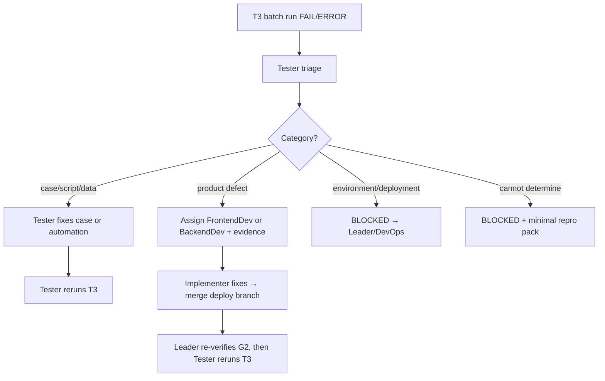

# T3 Automation Failure · Triage

**Responsible Agent**: **@Tester** (acceptance-criteria verifier).  
Implementers (FrontendDev / BackendDev) must **not** edit test cases themselves to "turn it green", unless Tester's triage concludes "test-case error" and the work has been assigned in writing.

---

## Flow (on FAIL or ERROR)



---

## Triage categories

| Category | Typical signals | Owner | Next step |
| --- | --- | --- | --- |
| **T-Case** | Steps do not match PRD/AC; locator is stale but the UI is correct; Apifox assertion too brittle; dirty test data | **Tester** | Revise T1/automation → rerun; major revisions go through `multica-review-test` |
| **T-Product** | Repro steps match the AC but actual differs from expected; API 5xx/error code differs from the contract | **FrontendDev / BackendDev** (assigned by Tester) | File a defect description + AC + logs; the implementer fixes the code and **must not delete tests or lower the bar** |
| **T-Env** | deploy_url unreachable; G2.5 not PASS; wrong Apifox environment variables | **Leader / DevOps** | BLOCKED; rerun after the comment is supplemented |
| **T-Blocked** | Cannot reproduce reliably; missing permissions/accounts | **Leader + human** | BLOCKED; list what a minimal repro needs |

---

## Tester triage output (required)

```markdown
## T3 Triage - {JIRA_KEY}

| Item | Value |
| --- | --- |
| Failed case / CASE-ID | |
| Triage verdict | T-Case / T-Product / T-Env / T-Blocked |
| Basis | Log excerpt + AC- comparison |
| Next owner | @Tester / @FrontendDev / @BackendDev / @Leader |
| Rerun T3? | After the fix / rerun now |
```

- **T-Product**: must @ a specific role and attach **AC-, expected, actual, screenshot/logs**  
- **Forbidden**: Backend editing pytest/Apifox assertions without triage; Tester ruling a product FAIL and closing the Issue without triage

---

## Relation to G3

- Until triage is complete, the overall verdict stays **FAIL** or **BLOCKED** (not PASS)  
- Only Tester may switch the corresponding AC to PASS after a passing rerun  
- Leader G3 relies on Tester's merged report
